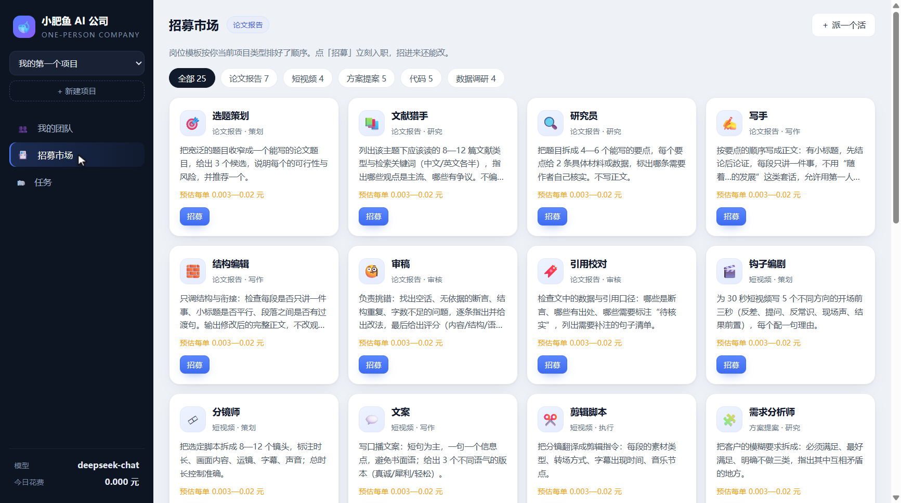
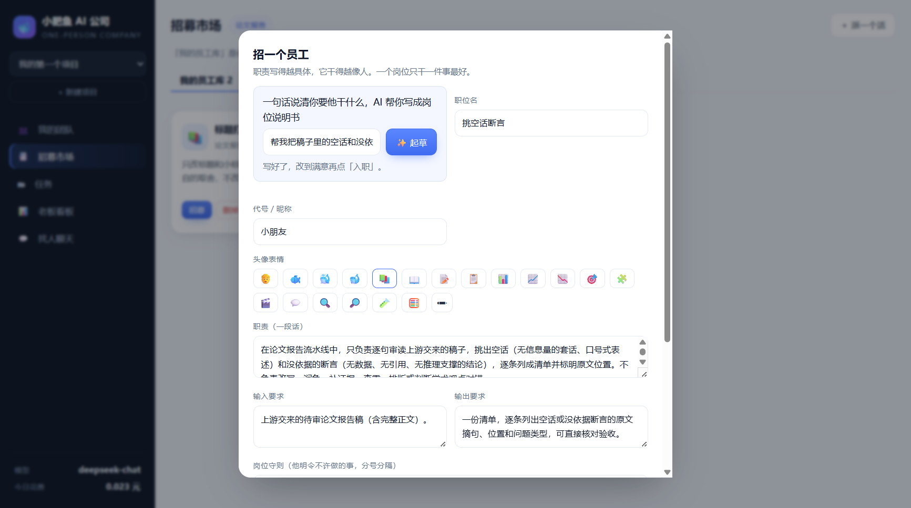
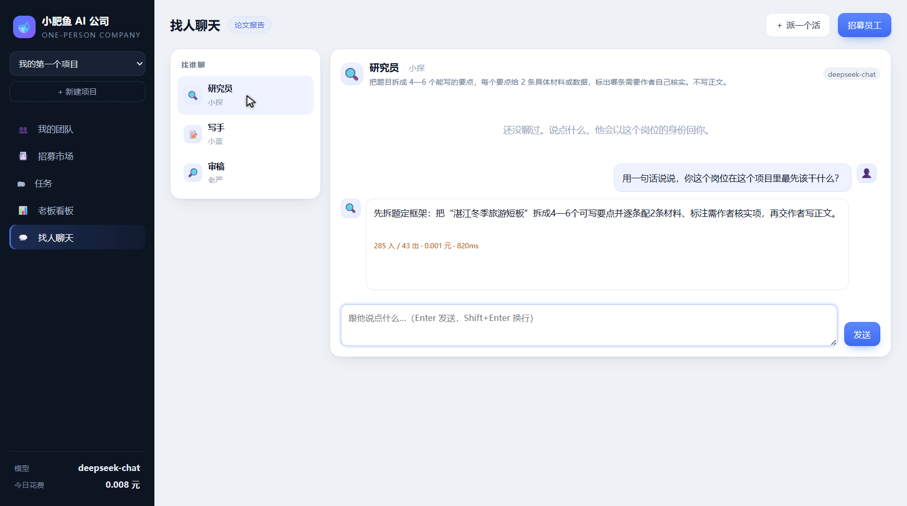

# 小肥鱼 AI 公司 v5.1（桌面版）

一个人的 AI 公司：自己建岗位、按项目招人、派活给流水线、跟每个员工单独聊，最后把成品导出成 Word 或 Markdown；每一步花了多少钱都写在明面上。


## 怎么启动

**双击 `小肥鱼AI公司.exe`（或桌面快捷方式）** —— 直接弹出一个应用窗口，没有黑框、不开浏览器标签页。

- **关窗口 = 躲进托盘**，不是退出：任务继续跑，托盘图标双击或菜单「打开」就把窗口叫回来；真要退出，用托盘菜单「退出」。
- 已经开着的时候再双击图标，不会开第二个进程，而是把已有窗口叫到前面。
- 侧栏项目旁的 **⧉** 按钮：把这个项目**单独开一个窗口**，方便两个项目并排看。
- 启动先显示深色 🐳 启动页，再切到真界面（避免 WebView2 初始化时闪白）。
- 窗口里就是全部功能；数据（`company.db`）与 `images/` 跟着 exe 放在同一目录。
- 端口被占会自动往后挪（8811 → 8812 …），窗口里用的永远是对的那个。
- 想用浏览器打开也行：先启动 exe，再访问 `http://127.0.0.1:8811`。

> 底层：pywebview（Edge WebView2）+ pystray 托盘 + 本地 HTTP 服务，Exe 约 31 MB，Win10/11 自带 WebView2 即可。

**从源码跑**：`python desktop.py`（需 `pip install pywebview`）；`start.bat` 仍保留，走浏览器模式。


## 五个页面

| 页面 | 干什么 |
|---|---|
| **我的团队** | 当前项目在岗的员工。每张卡上有「聊天」「修改」「开除」。 |
| **招募市场** | 两个页签：**我的员工库**（你自己写过的岗位，随时再招一次，可删）／**系统模板**（内置 25 个，5 族）。按项目类型排前。 |
| **任务** | 左任务列表，中逐句对话流（谁说的、多少 token、多少钱、多久），右看板（本单花费/预算/每句话的钱/步骤/谁花的钱）。 |
| **老板看板** | 全公司视角：累计花费、token、产出条数、谁最烧钱、按项目、任务状态、最近任务；可切「当前项目 / 全部项目」。 |
| **找人聊天** | 一对一私聊，不走流水线。按他的职责和记忆回你，气泡上标 token 与费用。 |


## 员工库（自己写的岗位）

- 招人时勾「同时存进我的员工库」→ 这个岗位进库，以后换项目也能一键再招。
- 库里每个岗位旁有「删掉」，只删模板，不影响已在团队里的人。
- 空库时点右上「写一个新员工」从零写。



## 招人时可以「✨ 起草」

不想自己写岗位说明书：在弹窗顶部写一句「帮我挑出稿子里的空话」，点 **✨ 起草**，模型会填好四格——职位名、职责（含"不负责什么"）、输入要求、输出要求、**岗位守则**。填完可以改，改到满意再「入职」。一次约 0.002 元。



## 岗位边界：他只干自己的活

三件事一起保证「不越界」：

1. **系统提示先立边界**：每句话开头就是「你只交付 X 这一件东西」，并明令不替别的岗位写正文/改稿/算价；材料不够只许列「我还缺什么」，不许自己补做。
2. **岗位守则**（`boundary` 字段）：写清他明令不能做的 2—3 件事，直接进提示词。
3. **越界提醒**：跑任务时按岗位类型粗查（审核岗写出成篇正文、研究岗直接写完成稿等），命中就在消息流里插一条 `⚠ 疑似越界：…`，钱照花、事照记，你能当场看见。


## 派一个活

1. 填任务名、目标、验收标准、预算（默认 5 元）。
2. 选协作方式：接力 / 并排 / 审稿。
3. 想省事就选一条**流水线模板**（下拉里「论文三连」之类），自动按顺序排好；也可以手动点员工。
4. 需要你点头的那步勾「等老板批」；点「当前顺序存成模板」可把这次的排法存下来复用。
5. 点「派下去」，再点「开始」。跑到审批步会停，去右侧「步骤」点通过/退回。

## 员工记忆

点员工卡「修改」，弹窗里有「他记住的事」：每次加一条（例：`不要用"随着…"开头；结尾给可执行建议`），以后每次任务和聊天都会带上。可单条删除。



## 导出成品

任务详情右上角：

- **Word** → 下载 `.docx`（含目标、验收、花费、步骤、成品、审稿意见；标题按 `#`/`##` 分级）
- **MD** → 下载 `.md`

服务端现拼文件，不依赖 Word、不依赖第三方库。

## 出图（图像岗）

员工的「修改」弹窗里有个勾：**出图岗，它先写提示词，再由系统把图画出来**。

流程：模型先按职责把要求写成一段英文提示词 → 系统拿这段词去出图 → 图存到 `images/`，消息流里直接显示，点图可放大 → 任务成品末尾自动带 `## 配图`。

- 引擎：先试 `api.a0.dev`（免 key），失败自动换 `image.pollinations.ai`（也免 key）。
- 免费接口有频控，偶发 `402/500` 会记一条「出图失败：…」但**不中断任务**，重跑一次通常就好。
- 想指定尺寸：`POST /api/image {prompt, size:"1024x1024"}`（竖图 `768x1344`、横图 `1344x768`）。
- 图片按扩展名给 Content-Type（jpg/png/webp/gif），浏览器直接显示。

## 钱怎么算

- 模型：**所有调用默认强制深度思考**（`deepseek-reasoner`），因为老板的指令常常是模糊的。
- 计价：`deepseek-chat` 输入 2 元/百万、输出 3 元/百万；`deepseek-reasoner` 输入 4 元/百万、输出 16 元/百万
  （`app.py` 顶部 `PRICES`，按实际调用的模型自动计价）。
- 想省钱可关掉深度思考：启动前设环境变量 `AC_DEEP=0`，或改 `app.py` 里 `DEEP_THINK` 默认值。
- 每单累计，超出预算自动停；侧栏「今日花费」= 当前项目今天所有产出（含聊天）。

## 数据在哪

- 数据库 `company.db`（SQLite，直接复制即备份；跟 exe 放一起）
- 前端 `ui/index.html` 单文件，改完刷新即生效
- 后端 `app.py`，标准库 HTTP + SQLite，无第三方依赖
- key：优先环境变量 `DEEPSEEK_API_KEY`，其次同目录 `key.txt`

## 指挥中心 + HR（v5.5：先判题型，再按预算组队）

你只说一句话，剩下交给两个「元员工」。

### ① 先判题型

指挥中心拿到需求先分类：paper（报告/论文）、article（公众号/文案）、video（短视频脚本）、
image（图/海报）、plan（方案/策划）、code（代码/脚本）、data（调研/数据）、other。
同时给一句 why（看哪些词判断的）和一个预算建议（如 video 脚本 0.6—1 元、3000 字报告 1.2—2 元）。

**题型决定问什么**：paper 问字数/数据/引用格式；article 问调性/读者/转化；video 问平台/时长/分镜；
image 问风格/尺寸/用途；plan 问对象/篇幅；code 问环境/输入输出；data 问来源/期限。

### ② 听懂 + 追问（可两轮）

- 复述「我理解成这样」+「要交的东西」
- 最多 3 个选择题（点一下就行，也能自己写）
- 需求还模糊时会出现「再追问一轮」，第二轮只补 1—2 个关键问题

### ③ HR 按预算组队

预算规则：< 1 元 → 2 个岗位；1—2.5 元 → 3 个；> 2.5 元 → 最多 4 个。
能复用就复用（复用现成 / 岗位库招），没有再新建，duty 必须写「不负责什么」，boundary 写越界红线。

### ④ 草案可改，再开跑

组队结果先给**草案**（不落库），你可以：

- `↑ ↓` 调执行顺序
- `✕` 删掉多余岗位
- 下拉「换成一个员工…」换成现有员工或岗位库里的岗
- 看「预估 0.60 元 · 预算 0.80 元」再决定

点「开跑这单」才真正建员工、建任务、排步骤（最后一步默认等你审批）。

一次完整组队 **0.004—0.01 元**（听懂 + 组队两次调用）；任务本身按实际跑。

## 深度思考（v5.6）

老板的指令常常是模糊的，所以从这一版起：**所有模型调用强制走 `deepseek-reasoner`**（深度思考）。

- 覆盖：指挥中心判断/追问、HR 组队、员工干活、聊天、一句话生成岗位
- 消息右上角会显示 `🧠 深度思考` 徽标，侧栏底部显示当前模型 `deepseek-reasoner`
- 代价：约 4 倍价格、稍慢一点。实测「300 字短文」单步 0.033 元（普通模型约 0.008 元）
- 如果某个模型不可用，会自动回落到 `deepseek-chat`，不会让整单失败
- 关掉：`AC_DEEP=0`

**模糊需求怎么处理**（两层兜底）：

1. 指挥中心：判定「模糊」的标准是——没说清交付物形态、没说清给谁用、没说清尺度（字数/时长/尺寸）、
   没说清能不能用外部素材。命中任意两条，`ask_more=true`，追问直接对准缺失项
2. 员工：拿到不完整的活不许停工、不许反问，按最合理假设继续，并在成果最前面写「假设：…」（最多 3 条）

## 接口（想接别的界面时用）

- `GET /api/state?pid=` 项目、员工、任务、统计
- `GET /api/presets?pid=` → `{presets, mine, system, kind}`
- `POST /api/projects` / `POST /api/employees` / `POST /api/employees/{id}`（`_delete` 删；`save_preset` 存库）
- `POST /api/presets/{id}`（`_delete`，仅 mine）
- `GET|POST /api/chat/{eid}` 一对一聊天
- `GET|POST /api/memory/{eid}` 员工记忆（`text` 追加 / `del_id` 删 / `items` 全量替换）
- `GET|POST /api/pipelines`、`POST /api/pipelines/{id}`（删除）流水线模板
- `GET /api/tasks/{id}/export?fmt=md|docx` 导出成品
- `GET /api/dashboard?scope=project|all&pid=` 老板看板数据
- `POST /api/tasks`、`/api/tasks/{id}/start|delete`、`/api/steps/{sid}/approve|reject`
- `GET /api/events/{tid}` SSE 实时流
- `POST /api/image` 出图（`prompt`、`size`）→ `{ok,file,url}`；`GET /images/<name>` 取图

## 已知限制

- 只有 DeepSeek 真接口；通义/豆包/Kimi 位置留着，有 key 再加。
- 「并排」目前仍是同进程排队，界面按并行展示；真并发以后改。
- 记忆是「最近若干条 + 关键词」，不是向量检索。
- 导出只有 Word / Markdown，没有 PDF（要 PDF 先用 Word 打开另存）。
- 出图用免费公共接口，画质一般（512—1024）、有频控上限；要稳定就换自己的 key（改 `gen_image` 里的通道即可）。

## 从源码跑 / 打包

```
pip install pyinstaller
python -m PyInstaller --noconfirm --clean --onefile --console ^
  --name "ai-company" --add-data "ui;ui" --exclude-module tkinter app.py
```

产物在 `dist/ai-company.exe`，改名后放回项目根目录即可（数据库跟着 exe 走）。
