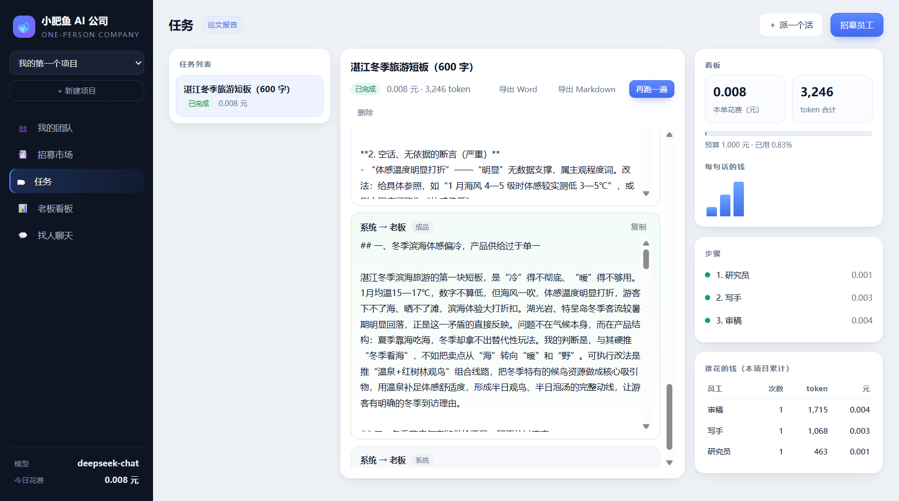
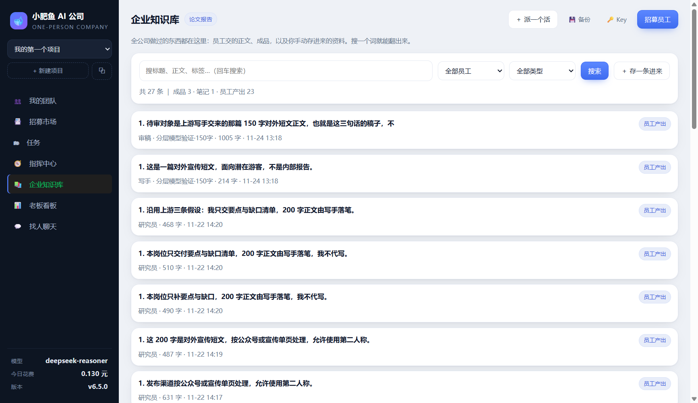
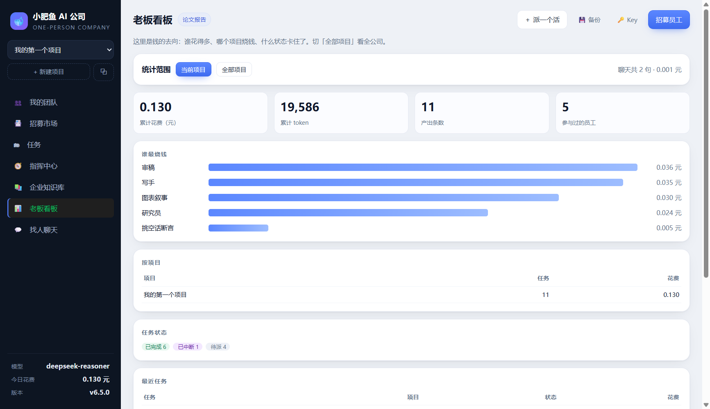

# 小肥鱼 AI 公司 · v6.5

**一个人的 AI 公司**：自己建岗位、按项目招 AI 员工、派活给流水线、跟每个员工单独聊，成品导出 Word / Markdown；每一句花了多少钱都写在明面上。

Windows 桌面应用（约 32 MB），数据全在本机，只用 DeepSeek 一个 key。



---

## 下载

两种方式，**只能二选一**（绿色版和安装版各存一套数据）：

| 方式 | 适合 | 怎么做 |
|---|---|---|
| **安装版** | 想有开始菜单和卸载项 | 到 [Releases](https://github.com/chen200006/xiaofeiyu-ai-company/releases/latest) 下 `XiaoFeiYuAI-Setup-x.y.z.exe`，双击安装（免管理员权限） |
| **绿色版** | 想放 U 盘 / 不动系统 | 下 `xiaofeiyu-ai-company-vX.Y.Z.exe`，放到任意文件夹双击；数据就存在它旁边 |

第一次启动要是全白屏，说明系统缺 WebView2 —— 装一下 [Evergreen 运行时](https://developer.microsoft.com/microsoft-edge/webview2/) 即可（Win11 一般自带）。

## 三分钟上手

1. **填 Key**：点右上角 **🔑 Key**，粘 `sk-` 开头的 DeepSeek key（在 [platform.deepseek.com](https://platform.deepseek.com/api_keys) 申请）。key 只写本机 `key.txt`，不上传、不进数据库。
2. **建项目**：左上「＋ 新建项目」，选个项目类型（论文报告 / 短视频 / 方案提案 / 代码 / 数据调研）。
3. **说需求**：进 **🧭 指挥中心**，用大白话写要什么，点「让指挥中心判断 + 听懂」——
   - 它会先判题型，给一句「我理解成这样」+ 交付物 + 预算建议；
   - 有问题会反问你 3 个选项题，你点或者自己写；
   - 然后把用人需求丢给 **👔 HR**：按预算在员工库挑人，挑不到就现场造一个，并写清每个岗位「不负责什么」。
4. **确认后开跑**：草案可以 ↑↓ 调顺序、✕ 删、换成别的人；点「开跑这单」，任务就变成一个微信群，谁在干什么、花了多少，全在群里。


---

## 它到底能干什么

### 指挥中心 + HR（会自己组队）

- **先判题型**：论文报告 / 文章 / 短视频 / 图片 / 方案 / 代码 / 数据 / 其他，八类各有各的追问方式。
- **先谈清再干活**：模糊需求会追问到能落地的程度；你嫌烦就说「按你的判断来」。
- **按预算配人**：预算 0.8 元就排 2—3 个岗，10 元可以排 5—6 个岗，超预算会明说取舍理由。
- **草案可改**：开跑前你能改人、改顺序、删岗、调预算；改完才真正建任务、花钱。

### 分层模型（贵的想，便宜的写）

| 岗位类型 | 模型 | 实测单价 |
|---|---|---|
| 审核类（审稿 / 核对 / 挑错 / 质检 / 验收） | `deepseek-reasoner` | 约 0.032 元/步 |
| 执行类（研究员 / 写手 / 文案 / 分镜 / 出图师） | `deepseek-chat` | 约 0.003 元/步 |

两步任务（写手 → 审稿）实测 **0.0349 元**；全部走 reasoner 约 0.07 元 —— 省一半，三步以上流水线通常省 60%—70%。

### 两道对抗审查

1. **审稿/核对岗**（reasoner）看结构、逻辑、是否照验收标准。
2. **第二道换模型审查**（chat）只挑错不重写，专抓数字没出处、套话、字数不达标 —— 换个模型才挑得出自己放过的地方。

### 企业知识库

全公司做过的东西都在里面：员工交的正文、成品、你手动存的资料。跑任务时自动翻 3 条相关的塞给这位同事当参考，并在群里说一句「给这位同事翻了 N 条公司知识库」。可以搜、可以筛人、可以筛类型。



### 花钱看得见

- 每句话后面标 token 与元；每个员工、每个项目、每个任务都能算出花了多少。
- 硬预算：每步之前按均价预估，快超了就停下标「超预算」，不偷偷烧钱。
- 不满意就「👎 重做这一步」：只重跑这一步及之后，前面已完成的沿用，不重复付费。



### 不怕丢数据

- 每 6 小时自动备份 `company.db`，保留最近 12 份；也能手动「💾 备份」。
- 一键回滚到某个时间点（回滚前会先把当前库另存一份 `before-restore`）。
- 启动时自检数据库（`PRAGMA quick_check`），坏库会被另存而不是直接崩。
- 上次异常退出留下的「进行中」任务不会假装在跑，会被标成「已中断」。

### 其他

- **25 个岗位模板**，分 5 族；招人时可以 **✨ 起草**（一句话让模型写岗位说明书，含「不负责什么」）。
- **岗位守则**：每个员工都有边界，越界会被提醒，避免写手去改稿、审核去重写。
- **出图**：给「出图师」岗位派活，先写英文提示词再出图，成品附 `## 配图`。
- **导出**：任务成品一键导出 Word 或 Markdown。
- **多人窗口**：侧栏项目旁 **⧉** 可以把这个项目单独开一个窗口，两个项目并排看。
- **托盘**：关窗口 = 躲进托盘（任务继续跑），托盘「打开」叫回来。

---

## 数据在哪

| 东西 | 位置 |
|---|---|
| 全部公司数据 | `company.db`（SQLite，和 exe 同目录） |
| 生成的图片 | `images/` |
| 备份 | `backups/`（最近 12 份） |
| Key | `key.txt`（本机，已加入 .gitignore） |

想搬走整个公司：复制 `company.db` + `images/` 两个东西就够。

---

## 从源码跑 / 自己构建

```bash
pip install pywebview pystray pillow
python desktop.py            # 桌面窗口
python app.py                # 只跑服务，浏览器开 http://127.0.0.1:8811
```

打包成 exe：

```bash
python -m PyInstaller --noconfirm --clean --onefile --windowed \
  --name "xiaofeiyu-ai-company" --icon icon.ico --add-data "ui;ui" \
  --collect-all webview --collect-all pystray \
  --hidden-import clr --hidden-import pythonnet --hidden-import pystray._win32 \
  --exclude-module tkinter desktop.py
```

生成安装包：装 [Inno Setup 6](https://jrsoftware.org/isdl.php)，然后 `ISCC.exe installer.iss`。

### 环境变量

| 变量 | 作用 |
|---|---|
| `DEEPSEEK_API_KEY` | 优先于 `key.txt` |
| `AC_PORT` | 固定端口（默认 8811，被占自动 +1） |
| `AC_DEEP=0` | 关掉强制深度思考（全部回落 chat，省钱但变笨） |
| `AC_REVIEW2=0` | 关掉第二道换模型审查 |

---

## 常见问题

**启动时 Windows 说「已保护你的电脑」**
点「更多信息 → 仍要运行」。没做代码签名（一年几千块，暂时不划算）。

**杀软报毒**
PyInstaller 打的单文件 exe 常被误判。加白名单，或用安装版。

**窗口全白**
缺 WebView2，装 Evergreen 运行时。

**提示 402 / Inadequate Balance**
DeepSeek 余额不足，充值后重试。

**能多人一起用吗**
不能。这是单人本地应用，数据在你自己电脑上，没有服务端。

---

## 版本备注

- **v6.5** 分层模型 + 第二道换模型审查 + 监工线程（15 分钟无动静群里喊话）
- **v6.4.1** 指挥中心 / HR / 系统 成为内置岗位（不可招、不可开除）
- **v6.4** 任务页改成微信那样（会话列表、白绿气泡、绿发送条）
- **v6.3** 真正的安装包（Inno Setup，卸载前自动备份数据）
- **v6.2** 👍/👎 单步重做、硬预算
- **v6.1** 自动备份、回滚、数据库自检、中断恢复
- **v6.0** 任务变成群聊，审批在群里 @老板
- **v5.7** 企业知识库
- **v5.6** 全量强制深度思考
- **v5.5** 判题型 + 预算配人 + 可改草案
- **v5.4** 指挥中心 + HR

完整记录见 [Releases](https://github.com/chen200006/xiaofeiyu-ai-company/releases)。

---

## 说两句实话

这不是「自动化一切」的魔法。它擅长的是：**结构清楚的文字活**（报告、方案、脚本、文案、调研），以及把一件事拆成 4—6 个岗位接力的流程。

它不擅长：需要看屏幕、点按钮、打电话、跟真人来回拉扯的活。

花钱这件事要盯着：一个 3000 字报告大约 0.03—0.10 元，看着便宜，但一天跑二十单也是钱。看板就是为这个做的。

## License

MIT
